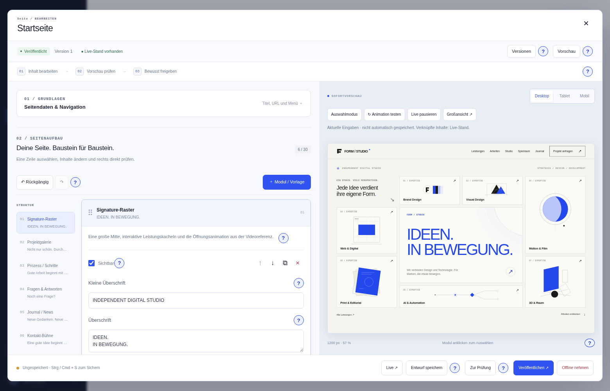
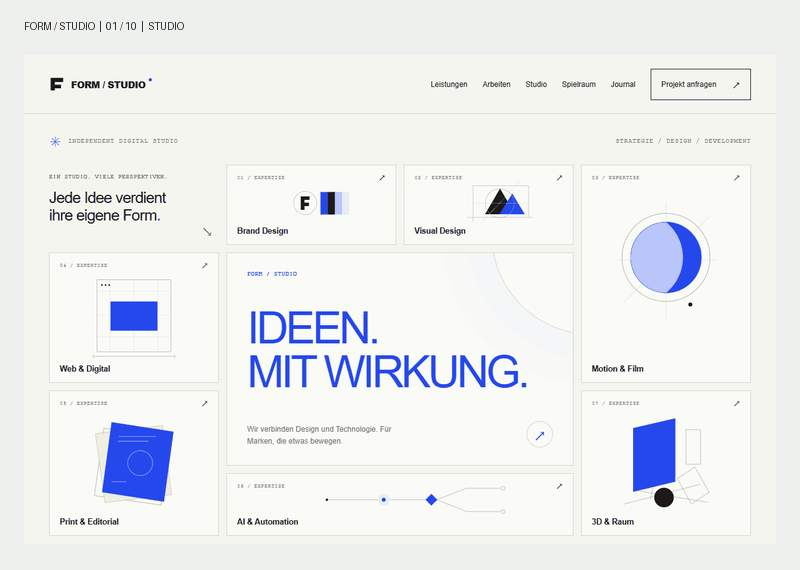

<!-- Portfolio: local animated SVGs, verified project descriptions, real product screenshot. -->

<p align="center">
  <a href="#scanora">
    
  </a>
</p>

<h3 align="center">Turning paper into information. Turning ideas into tools.</h3>

<p align="center">
  I'm <strong>Jerome</strong>, a software developer and the founder of <strong><a href="https://scanora.org">Scanora</a></strong>, based in Germany.<br />
  I build document workflows, automation, websites, and open-source tools that make everyday work simpler.
</p>

<p align="center">
  <a href="#scanora"><strong>Scanora</strong></a> &nbsp; / &nbsp;
  <a href="#projects"><strong>Selected work</strong></a> &nbsp; / &nbsp;
  <a href="#all-projects">All projects</a> &nbsp; / &nbsp;
  <a href="#about">About</a> &nbsp; / &nbsp;
  <a href="#lets-connect">Contact</a>
</p>

---

## Scanora

<sub>01 / MAIN FOCUS · DOCUMENT DIGITIZATION &amp; AUTOMATION</sub>

<p align="center">
  <a href="https://scanora.org">
    
  </a>
</p>

### Paper records become documents you can actually find.

I founded **[Scanora](https://scanora.org)** to help **businesses, law firms, and medical practices** turn paper archives into **searchable PDFs**, with **quality checks and structured delivery**.

**My role:** Founder · Software developer<br />
**The focus:** Make documents easier to find, review, and work with.

| What we work on | What you get |
| --- | --- |
| **Digitization** | Physical records become digital documents. |
| **OCR** | Searchable text inside scanned PDF pages. |
| **Quality review** | Results checked before delivery. |
| **Organization** | Structured files for the next step in your workflow. |

**The software side:** I build tools for processing documents, reviewing results, organizing files, and reducing repetitive work. Document digitization and software development come together here; that practical focus also shapes my open-source projects.

<p align="center">
  <a href="https://scanora.org"><strong>Explore Scanora &rarr;</strong></a> &nbsp; · &nbsp;
  <a href="mailto:jerome.weber@scanora.org?subject=Scanora%20document%20digitization"><strong>Discuss a digitization project &rarr;</strong></a><br /><br />
  <sub>Germany · Sankt Augustin · Bonn · Cologne · Rhein-Sieg</sub>
</p>

---

## Projects

Selected open-source work — from visual publishing tools to document workflows and migration planning. Each project tackles a concrete task; the full directory follows below.

### FORM / STUDIO

<sub>02 / FORM / STUDIO · WEBSITES &amp; CONTENT</sub>

**Build the page. Review the changes. Publish when it's ready.**

An open-source website builder for composing pages without writing code. Reusable content blocks and **ten design packages** provide the starting point; a live preview, revisions, and an approval workflow keep editing deliberate.

<p align="center">
  <a href="https://github.com/NorphyOG/form-studio">
    
  </a>
</p>

**Inside:** visual page editing · live preview · media library · revision history · role-based access

<details>
  <summary><strong>See the design packages in motion</strong></summary>

<p align="center">
  <a href="https://github.com/NorphyOG/form-studio">
    
  </a>
  <br />
  <sub>Actual product capture from the project's documentation.</sub>
</p>

</details>

**Built with:** TypeScript · FastAPI · SQLite<br />
[Explore FORM / STUDIO &rarr;](https://github.com/NorphyOG/form-studio)

### PDF Folder Sorter

<sub>03 / PDF FOLDER SORTER · DOCUMENT TOOLS</sub>

<p align="center">
  <a href="https://github.com/NorphyOG/PDF-Ortner-Sorter">
    
  </a>
</p>

**See the document before you decide where it belongs.**

A Windows app for sorting scanned PDFs across folders and subfolders. Cached previews of the first three pages help you inspect documents, select the right files, and move them with destination confirmation.

**Built with:** C# · .NET · WPF<br />
[Explore PDF Folder Sorter &rarr;](https://github.com/NorphyOG/PDF-Ortner-Sorter)

### CutoverSignal

<sub>04 / CUTOVERSIGNAL · MIGRATION TOOLING</sub>

<p align="center">
  <a href="https://github.com/NorphyOG/cutoversignal">
    
  </a>
</p>

**Find EWS dependencies before planning a move to Microsoft Graph.**

A credential-free CLI and GitHub Action that detects SDK and SOAP patterns in source code, including .NET projects and PowerShell. It produces a local report as a starting inventory for migration planning.

**Built with:** TypeScript · Node.js · GitHub Actions<br />
[Explore CutoverSignal &rarr;](https://github.com/NorphyOG/cutoversignal)

---

## All projects

Every public repository, briefly introduced. **11 repositories**, grouped by what they do.

### Build & migrate

| Repository | What it does | Built with |
| --- | --- | --- |
| [FORM / STUDIO](https://github.com/NorphyOG/form-studio) | An open-source website builder and editorial CMS with reusable content blocks, ten design packages, and a draft-to-publish approval workflow. | TypeScript · FastAPI · SQLite |
| [CutoverSignal](https://github.com/NorphyOG/cutoversignal) | A credential-free CLI and GitHub Action that finds EWS dependencies in source code to help plan a move to Microsoft Graph. | TypeScript · Node.js |

### Desktop, documents & media

| Repository | What it does | Built with |
| --- | --- | --- |
| [Multi Auto Clicker](https://github.com/NorphyOG/multi-auto-Clicker) | Desktop automation with multi-position clicking, global hotkeys, and a visual builder for JSON scripts. | Python |
| [PDF Folder Sorter](https://github.com/NorphyOG/PDF-Ortner-Sorter) | A Windows app to preview scanned PDFs, select documents, and organize them into folders. | C# · .NET · WPF |
| [plugin-pySys](https://github.com/NorphyOG/plugin-pySys) | A modular desktop dashboard for file backups, duplicate detection, a media library, audio tools, and format conversion. | Python · PySide6 |
| [MP4 to MP3](https://github.com/NorphyOG/mp4-to-mp3) | Batch-convert video files to MP3 from the command line, with configurable bitrates and optional recursive folder scanning. | Python · FFmpeg |
| [Mikroskop App](https://github.com/NorphyOG/mikroskop-app) | A Windows-focused USB microscope viewer with live adjustments, image capture, and image analysis. | Python · OpenCV · Tkinter |

### Games & experiments

| Repository | What it does | Built with |
| --- | --- | --- |
| [TCS Remaster Installer](https://github.com/NorphyOG/tcs-remaster-installer) | A Windows modpack installer for LEGO Star Wars: The Complete Saga, with checked overlays and backups. Technical preview; no game assets included. | Python |
| [Minecraft Server Manager](https://github.com/NorphyOG/Minecraft-Server-Manager) | A Windows desktop manager for local Paper and Velocity servers, with setup wizards, a live console, and configuration tools. | C# · .NET · Avalonia |
| [PylaAI-N](https://github.com/NorphyOG/PylaAI-N) | A personal PylaAI fork for Brawl Stars experiments with behavior trees, reinforcement learning, and an overlay. | Python |

### This profile

| Repository | What it does | Built with |
| --- | --- | --- |
| [NorphyOG](https://github.com/NorphyOG/NorphyOG) | This portfolio: Scanora, selected work, the complete public project directory, and locally generated profile art. | Markdown · HTML |

<p align="center">
  <a href="https://github.com/NorphyOG?tab=repositories"><strong>Browse all public repositories &rarr;</strong></a>
</p>


---

## About

I'm **Jerome**, the developer behind **NorphyOG**, based in Germany. I founded **Scanora** and build practical tools around document workflows, automation, and content. AI and game development are my side quests.

I like projects that start with “there has to be a better way to do this.” My approach is to understand the work, simplify it, and build something useful.

### Toolbox

| Focus | Tools |
| --- | --- |
| **Languages & applications** | TypeScript · Python · C# · .NET · Node.js · Angular |
| **Data & documents** | FastAPI · SQLite · REST APIs · OpenCV · OCR workflows |
| **Development & infrastructure** | Git · GitHub Actions · Docker · Azure |
| **Game development** | Unity · Godot |

<details>
  <summary><strong>Open the developer terminal</strong></summary>

<p align="center">
  
  
</p>

```ts
const norphy = {
  name: "Jerome",
  building: "Scanora",
  focus: ["automation", "document workflows", "developer tools"],
  sideQuests: ["AI experiments", "game development"],
  approach: "understand → simplify → build → improve",
  discord: ".norphy",
};
```

</details>

## Activity

<p align="center">
  <code>norphy@github:~$ ./contributions</code><br /><br />
  <a href="https://github.com/NorphyOG?tab=overview">
    
  </a>
  <br />
  <sub>Real GitHub contributions. Generated in this repository and refreshed daily by GitHub Actions.</sub>
</p>


---

## Let's connect

**A document digitization project?** Let's talk about your paper archives and the digital output you need.<br />
[Contact Scanora &rarr;](mailto:jerome.weber@scanora.org?subject=Scanora%20document%20digitization) · [scanora.org](https://scanora.org)

**Software, automation, or an open-source collaboration?** Tell me what you're working on.<br />
[Email Jerome &rarr;](mailto:jerome.weber@scanora.org) · Discord: `.norphy`

<p align="center">
  <code>norphy@github:~$ build something useful</code>
</p>

<!-- SVG covers are original illustrations generated locally, not product
     screenshots. FORM / STUDIO's editor screenshot and design animation are
     unchanged captures from its public documentation. Source links and
     regeneration notes are in scripts/README.md. -->
